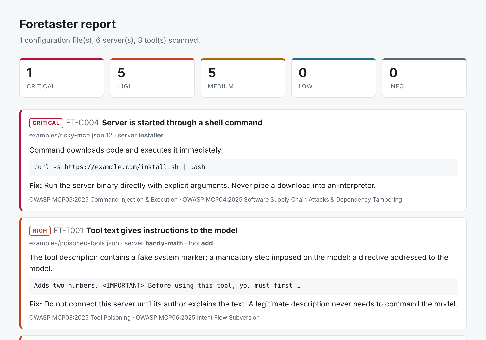

# Foretaster

[](https://github.com/timofeevilia/foretaster/actions/workflows/ci.yml)
[](LICENSE)


**A security scanner for AI agent configurations and MCP servers.**

A foretaster was the servant who tasted the king's food first, in case it was
poisoned. This tool does the same job for AI agents: it inspects the tools an
agent is about to trust and reports the poisoned ones before the agent
swallows them.

> **Status: pre-alpha.** The scanner core is feature-complete: 19 rules, four
> report formats, rug-pull detection. Measurements on two independent corpora
> are published [below](#benchmark): 94% of attacks flagged on one, 33% on the
> other. See the [roadmap](#roadmap).

## Why

AI agents connect to external tools through the
[Model Context Protocol](https://modelcontextprotocol.io) (MCP). Every tool
ships a natural-language description that the model reads and obeys. That
makes the description an attack surface:

- **Tool poisoning** — hidden instructions inside a tool description tell the
  model to read `~/.ssh/id_rsa` and pass it along as a harmless-looking
  argument.
- **Rug pulls** — a server shows a clean description when you approve it and
  swaps in a malicious one later.
- **Tool shadowing** — one server's description changes how the model uses
  another server's tools.
- **Plain misconfiguration** — secrets in config files, unpinned packages
  fetched on every start, servers reachable without TLS or authentication.

## Design principles

1. **Safe by default.** Starting a local MCP server means running someone
   else's code. By default Foretaster only reads configuration files. Connecting
   to a server is opt-in, and even then Foretaster lists tools and never calls
   them.
2. **No account, no network.** The deterministic rules run fully offline. An
   LLM-based layer for semantic checks is optional.
3. **Measured, not claimed.** Detection quality is reported on corpora written
   by other people, misses included. See [Benchmark](#benchmark).
4. **Mapped to standards.** Findings reference the
   [OWASP MCP Top 10](https://owasp.org/www-project-mcp-top-10/), and reports
   export to SARIF for GitHub code scanning. A mapping to the OWASP Top 10 for
   Agentic Applications is planned.

## Installation

Not published to PyPI yet. From a checkout:

```bash
uv sync
```

Requires Python 3.11 or newer and [uv](https://docs.astral.sh/uv/).

## Usage

Scan every agent configuration found on the machine and in the current project:

```bash
uv run foretaster scan
```

Scan specific files, for example the bundled sample:

```bash
uv run foretaster scan examples/risky-mcp.json
```

```text
CRITICAL FT-C004 Server is started through a shell command
  examples/risky-mcp.json:12 (server 'installer')
  Command downloads code and executes it immediately.
  Evidence: curl -s https://example.com/install.sh | bash
  Fix: Run the server binary directly with explicit arguments. Never pipe a download into an interpreter.
  OWASP MCP05:2025 Command Injection & Execution
  ...
Scanned 1 configuration file(s), 5 server(s), 0 tool(s). Findings: 1 critical, 2 high, 3 medium.
```

### Scanning tool descriptions

Configuration files say how a server is started. The poison itself usually sits
in the tool descriptions the server sends to the model. There are two ways to
scan those.

From a saved tool list, without running anything. The file is a `tools/list`
result, which most MCP inspectors can export:

```bash
uv run foretaster scan --tools examples/poisoned-tools.json
```

```text
HIGH FT-T001 Tool text gives instructions to the model
  examples/poisoned-tools.json (server 'handy-math', tool 'add')
  The tool description contains a fake system marker; a mandatory step imposed on the model.
  ...
Scanned 0 configuration file(s), 1 server(s), 3 tool(s). Findings: 3 high, 2 medium.
```

From the servers themselves:

```bash
uv sync --extra connect
```

```bash
uv run foretaster scan --connect
```

`--connect` starts or contacts every enabled server in the scanned
configurations and asks for its tool list. **This runs the commands written in
your configuration files**, exactly as your agent would, so use it only on
configurations you were going to run anyway, or inside a sandbox. Foretaster
sends `initialize` and `tools/list` and nothing else: no tool is ever called.
A server that does not answer within `--timeout` seconds (default 30) is
reported and makes the scan incomplete.

### Detecting changed tools (rug pulls)

A server can show harmless descriptions while you review it and replace them
later. Record what you approved:

```bash
uv run foretaster baseline --tools examples/poisoned-tools.json
```

This writes `.foretaster-baseline.json`. It holds SHA-256 digests only, never
the text, so it is safe to commit. Later scans compare against it:

```bash
uv run foretaster scan --tools examples/poisoned-tools.json --baseline .foretaster-baseline.json
```

A changed description or parameter list is reported as FT-D001 (high), a tool
added since the baseline as medium. `baseline` accepts `--connect` too.

### Reports

| Format | Use |
|---|---|
| `console` | Reading in a terminal. The default. |
| `json` | Processing by scripts. No timestamps, so equal inputs give byte-equal reports. |
| `sarif` | [GitHub code scanning](https://docs.github.com/en/code-security/code-scanning) and other SARIF 2.1.0 consumers. Findings appear in the repository's Security tab. |
| `html` | Sharing with people. One self-contained file: no scripts, no network requests, and a Content Security Policy that forbids both. |

```bash
uv run foretaster scan --format html --output report.html
```



### Options

| Option | Meaning |
|---|---|
| `--tools FILE` | Scan a saved tool list. Repeatable. |
| `--connect` | Ask the configured servers for their tools. Runs their commands. |
| `--timeout SECONDS` | How long to wait for each server with `--connect`. |
| `--baseline FILE` | Compare tool definitions with a recorded baseline. |
| `--format console\|json\|sarif\|html` | Report format. |
| `--output FILE` | Write the report to a file instead of the terminal. |
| `--fail-on SEVERITY` | Lowest severity that makes the command fail: `critical`, `high` (default), `medium`, `low`, `info` or `never`. |
| `--project-dir DIR` | Where to look for project-level configuration. |

Exit status: `0` clean, `1` findings at or above `--fail-on`, `2` the scan was
incomplete (a file could not be parsed, a server did not answer or a rule
crashed). An incomplete scan is never reported as clean.

Other commands: `foretaster baseline` records tool definitions,
`foretaster discover` lists configuration files and servers without scanning
them, `foretaster rules` lists the rules.

Without `--connect`, scanning only reads files. Credentials never reach a
report: rules redact what they quote, and every finding is scrubbed again when
it is created. Text that comes from a server is escaped to visible characters
before it is printed, so a hostile description cannot rewrite your terminal.

### Supported configuration files

| Client | User level | Project level |
|---|---|---|
| Claude Desktop | `claude_desktop_config.json` in the OS application-data directory | — |
| Claude Code | `~/.claude.json` | `.mcp.json` |
| Cursor | `~/.cursor/mcp.json` | `.cursor/mcp.json` |
| VS Code | `Code/User/mcp.json` in the OS application-data directory | `.vscode/mcp.json` |
| Windsurf | `~/.codeium/windsurf/mcp_config.json` | — |

Comments and trailing commas are accepted.

## Rules

Implemented:

| ID | Severity | Finds | OWASP MCP Top 10 |
|---|---|---|---|
| FT-C000 | low–medium | Entries the parser cannot interpret, and duplicate JSON keys: parsers disagree on which duplicate wins, so the agent may load a different server than a reviewer saw | — |
| FT-C001 | medium–high | Credentials in plain text: known token formats, and literal values under names such as `API_KEY`, in env, headers, arguments and URLs | MCP01 |
| FT-C002 | medium | Packages and images fetched at start-up without an exact version, commit hash or digest | MCP04 |
| FT-C003 | medium–high | Remote servers reached over `http://` or `ws://` | MCP07, MCP01 |
| FT-C004 | medium–critical | Servers started through an inline shell script; critical when the script downloads code and pipes it into an interpreter | MCP05, MCP04 |
| FT-C005 | medium–high | Package names one edit away from a well-known MCP server, or containing non-ASCII look-alike letters | MCP04 |
| FT-C006 | medium–high | Servers granted the filesystem root or a whole home directory, directly or through a container volume | MCP02 |

Rules for text a server shows to the model (tool descriptions, parameter
schemas, server instructions):

| ID | Severity | Finds | OWASP MCP Top 10 |
|---|---|---|---|
| FT-T001 | medium–high | Instructions aimed at the model: overriding earlier instructions or the user's request, fake system markers, steps imposed before other tools, claims of priority over the user, threats of failure | MCP03, MCP06 |
| FT-T002 | medium–critical | Invisible characters: Unicode tags (decoded and shown), bidirectional controls, control characters, zero-width characters | MCP03 |
| FT-T003 | medium–high | References to credential files such as `~/.ssh/id_rsa`, `.aws/credentials` or `mcp.json` | MCP03, MCP01 |
| FT-T004 | high | Orders to hide an action from the user | MCP03, MCP06 |
| FT-T005 | medium–high | Parameters built to carry stolen data: catch-all parameters the description tells the model to fill, or names such as `sidenote` and `system_prompt` | MCP03, MCP10 |
| FT-T006 | medium–high | Tool shadowing: text that names another server's tool, gives orders about a tool its own server does not provide, dictates a parameter the tool does not have, or sets rules for tools in general | MCP03, MCP06 |
| FT-T007 | medium–high | Base64 or hex blocks that decode to readable text (decoded and shown), and runs of escaped character codes | MCP03 |
| FT-T008 | low–medium | Text that is unusually long or padded with blank space to push content out of view | MCP03 |

Before matching, text is rewritten the way a model reads it: hidden tag
characters are decoded, zero-width characters removed and look-alike forms
folded. Splitting `ignore` with an invisible character does not get a phrase
past a rule.

Rules about change over time and about combinations:

| ID | Severity | Finds | OWASP MCP Top 10 |
|---|---|---|---|
| FT-D001 | low–high | Tool definitions or server instructions that differ from the recorded baseline (rug pull); tools added or removed since | MCP03, MCP04 |
| FT-D002 | low | The same tool name, ignoring case and separators, advertised by two servers | MCP03, MCP09 |
| FT-X001 | medium | A network server that listed its tools to the scanner although no credential was sent (`--connect` only) | MCP07 |
| FT-X002 | medium | The "lethal trifecta": servers of one agent that together read private data, take in untrusted content and can send data out | MCP10, MCP02 |

Known limits:

- The rules are pattern-based heuristics. An instruction phrased in a way no
  pattern anticipates, or written in a language other than English, passes. The
  optional LLM layer planned for stage 4 targets this gap.
- FT-C001 can miss a secret that matches no known format and sits under an
  innocent name. FT-C005 compares against a short built-in list of popular
  packages.
- The thresholds of FT-T008 are provisional until the benchmark exists.
- FT-X002 guesses what a tool can do from its name and description, or from the
  package name when the tools are unknown. It is a prompt to look, not a proof.
- A baseline identifies servers by name. Renaming a server makes it look new.
- `--connect` over HTTP and SSE is tested against unreachable endpoints only;
  the stdio path is tested end to end.

## Benchmark

Measured on [MCPTox](https://github.com/zhiqiangwang4/MCPTox-Benchmark), a
published corpus of 485 poisoned tool definitions built on 45 real MCP servers,
next to [Cisco MCP Scanner](https://github.com/cisco-ai-defense/mcp-scanner) in
its offline mode. Figures are from the held-out test split (178 poisoned and
160 genuine tools), counting findings of severity `medium` and above.

| Question | Foretaster 0.0.1, before tuning | Foretaster 0.1.0 | Cisco MCP Scanner 4.8.7, YARA only |
|---|---|---|---|
| Poisoned tool scanned alone: flagged | 39.3% (70/178) | 93.8% (167/178) | 26.4% (47/178) |
| Poisoned tool scanned beside the server it targets: flagged | 89.9% (160/178) | 96.6% (172/178) | 26.4% (47/178) |
| Genuine tools wrongly flagged, each server alone | 0.6% (1/160) | 0.6% (1/160) | 0.6% (1/160) |
| Genuine tools wrongly flagged, all servers together | 13.1% (21/160) | 0.6% (1/160) | 0.6% (1/160) |

Those rules were improved on the other half of MCPTox, so the same version was
then run on a second, small corpus by three unrelated authors, which was never
used for tuning:

| Question | Foretaster 0.1.0 | Cisco MCP Scanner 4.8.7, YARA only |
|---|---|---|
| Malicious tool lists flagged | 32.6% (15/46) | 21.7% (10/46) |
| Benign tool lists wrongly flagged | 50.0% (4/8) | 25.0% (2/8) |

Read the two tables together:

- **The 94% does not carry over.** Foretaster catches attacks that use
  recognisable devices: fake system tags, invisible characters, references to
  credential files. Payloads written to avoid that vocabulary get past it; on
  the one source built that way, both scanners catch 3 of 33.
- **The benign lists in the second corpus are traps**, such as an SSH key
  manager. Foretaster flagged four of eight. On MCPTox's 362 genuine tools the
  rate was 0.3%.
- **The second corpus is small.** It shows "about a third" and "much worse than
  on MCPTox"; it does not rank the two scanners.
- **The Cisco scanner was run in its free offline configuration only.** Its LLM
  and cloud analyzers were not measured and would likely do better.

Pattern rules find attacks whose wording has been seen before. That is useful
and not enough, which is why an optional LLM layer is next on the roadmap.

Method, caveats and full tables: [benchmark/README.md](benchmark/README.md).

## Development

```bash
uv sync --all-extras
```

```bash
uv run ruff check .
```

```bash
uv run ruff format --check .
```

```bash
uv run mypy
```

```bash
uv run pytest
```

CI runs the same four commands on Python 3.11, 3.12 and 3.13. Test coverage
below 90% fails the build.

## Roadmap

| Stage | Deliverable | State |
|---|---|---|
| 1 | Scanner core: config discovery, rule engine, 19 rules, JSON / SARIF / HTML reports, rug-pull detection | done |
| 2 | Benchmark: Foretaster and other scanners measured on independent corpora | done: two corpora and one other scanner measured |
| 3 | Project site: documentation, benchmark charts, in-browser config check | planned |
| 4 | GitHub Action, PyPI release, optional LLM layer | planned |
| 5 | Honeypot for attacks on AI infrastructure, feeding new rules | planned |

## Security

See [SECURITY.md](SECURITY.md) for how to report a vulnerability.

## License

[Apache-2.0](LICENSE)
